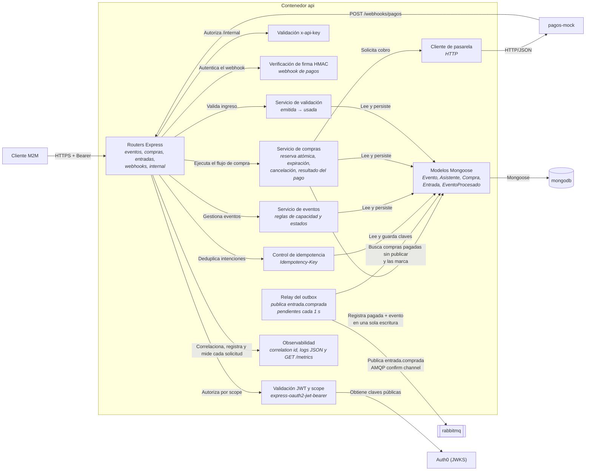
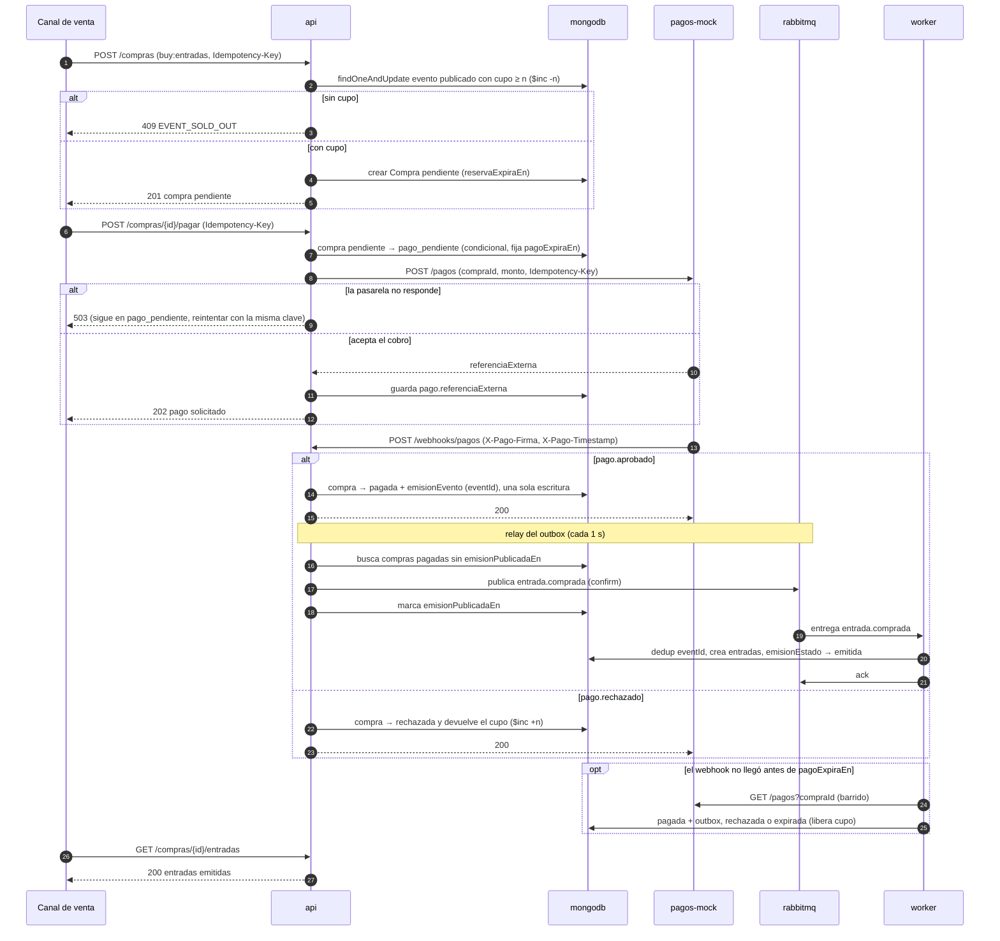

# C4 — Nivel 3: Componentes del contenedor `api`

**Alcance:** los componentes internos del contenedor `api` y sus relaciones. No baja a funciones ni clases. El worker se documenta en [docs/eventos](eventos/README.md).

**Leyenda:** rectángulo = componente · cilindro = base de datos · rectángulo de doble borde = broker de mensajes. Todos los componentes están implementados. Las flechas apuntan hacia quien **recibe** la llamada.

El formato de error uniforme ([`src/lib/errors.js`](../src/lib/errors.js), [ADR 0001](adr/adr-0001-estilo-api-rest.md)) lo usan todos los componentes: por eso no se dibuja como un componente más.

## Componentes y ubicación en el código

| Componente | Archivo |
|---|---|
| Routers Express | [`src/routes/`](../src/routes): `eventos`, `compras`, `entradas`, `webhooks` e `internal`. Solo autentican, validan el cuerpo contra el contrato (`src/lib/validar.js`) y llaman a los servicios |
| Validación JWT y scope | [`src/middleware/auth0.js`](../src/middleware/auth0.js) (`validateAccessToken`, `requireScope`) |
| Validación x-api-key | [`src/middleware/apiKey.js`](../src/middleware/apiKey.js) |
| Verificación de firma HMAC | [`src/middleware/webhook.js`](../src/middleware/webhook.js) y [`src/lib/firma.js`](../src/lib/firma.js) |
| Control de idempotencia | [`src/lib/idempotencia.js`](../src/lib/idempotencia.js) |
| Servicios de eventos, compras, pagos, entradas y reporte | [`src/services/`](../src/services) |
| Cliente de pasarela | [`src/lib/pasarela.js`](../src/lib/pasarela.js) |
| Modelos Mongoose | [`src/models/`](../src/models) |
| Relay del outbox | [`src/lib/outbox.js`](../src/lib/outbox.js) y [`src/lib/rabbit.js`](../src/lib/rabbit.js) ([ADR 0009](adr/adr-0009-outbox-entrada-comprada.md)) |
| Observabilidad | [`src/middleware/correlacion.js`](../src/middleware/correlacion.js), [`src/middleware/observabilidad.js`](../src/middleware/observabilidad.js), [`src/lib/logger.js`](../src/lib/logger.js) y [`src/lib/metricas.js`](../src/lib/metricas.js) ([ADR 0008](adr/adr-0008-observabilidad-correlation-id.md)) |

## Secuencia del flujo multi-paso

## Componentes del contenedor `worker`

El `worker` tiene dos responsabilidades: consumir `entrada.comprada` y ejecutar un **barrido** periódico (`BARRIDO_INTERVALO_MS`, 60 s). Todas las transiciones del barrido son `findOneAndUpdate` condicionales, así que varias réplicas pueden convivir ([ADR 0010](adr/adr-0010-ciclo-de-vida-compra-pago-conciliacion.md)).

| Componente | Responsabilidad | Archivo |
|---|---|---|
| Declaración de topología | Exchanges, colas, retry y DLQ (la misma que ejecuta `api`) | [`src/lib/rabbit.js`](../src/lib/rabbit.js) (`declararTopologia`) |
| Consumidor de `entrada.comprada` | `prefetch(1)` y ack manual después de persistir; valida el contrato, gestiona retry (`x-retry-count`) y DLQ | [`src/lib/consumidor.js`](../src/lib/consumidor.js) |
| Emisión de entradas | Una entrada por unidad con upsert por `(compraId, numero)`, titular del snapshot y registro del `eventId` al final | [`src/services/emision.js`](../src/services/emision.js) |
| Barrido de vencimientos | Reservas `pendiente` vencidas → `expirada` y libera cupo | [`src/lib/barrido.js`](../src/lib/barrido.js) |
| Conciliación de pagos | Compras `pago_pendiente` con `pagoExpiraEn` vencido: consulta `GET /pagos?compraId` a la pasarela y resuelve la compra | [`src/lib/barrido.js`](../src/lib/barrido.js) y [`src/services/pagos.js`](../src/services/pagos.js) |
| Reconciliación de cupo | Recalcula el cupo esperado por evento y lo corrige si la diferencia se repite en dos barridos | [`src/lib/barrido.js`](../src/lib/barrido.js) |
| Cierre de eventos | `publicado` → `finalizado` pasadas `EVENTO_FINALIZA_TRAS_HORAS` de la fecha, y cascada de cancelación ([ADR 0011](adr/adr-0011-ciclo-de-vida-evento.md)) | [`src/lib/barrido.js`](../src/lib/barrido.js) y [`src/services/eventos.js`](../src/services/eventos.js) |
| Métricas | Servidor HTTP propio con `GET /metrics` (`METRICS_PORT`) | [`src/lib/servidorMetricas.js`](../src/lib/servidorMetricas.js) |
